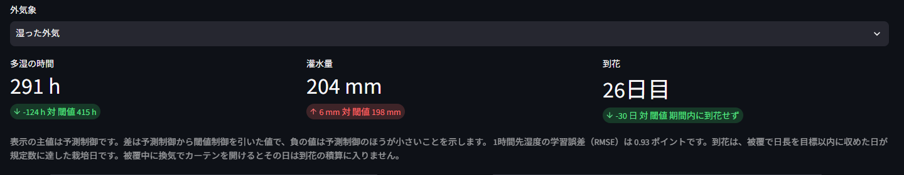
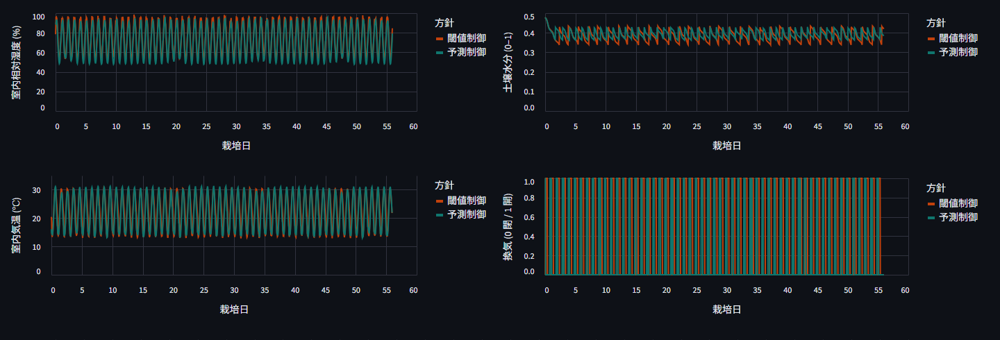

# ダリア栽培ハウスの制御比較


農業用ハウスで、既存の『ルールベース制御』から今後普及する『予測値ベース制御』に変えた場合のシミュレーションです。
ITエンジニア兼ダリア農家として、AIを使いつつ農家としての展開にも役立ちそうなモノ作り企画として作成しました。

外の天候を固定してハウスの中のみを制御します。簡略化されたものなので、同じ条件下での生育の比較の参考値としてご利用ください。  

## なぜ予測制御だと到花が早まるのか

このモデルの到花は、花が育つのが速い日ではありません。短日が成立した日を数えた日です。

被覆の時刻表は、閾値制御と予測制御で同じです。日照のうち、目標の明期からはみ出した時間を暗幕で覆います。その時間に換気でカーテンを開けると、その時間は光になり、その日は短日の積算から落ちます。

閾値制御は、今の湿度が 85% 以上、または気温が 32℃以上なら、被覆中かどうかを見ずに換気します。湿った外気では被覆中の換気が続き、短日が1日も成立しません。

予測制御は、被覆中に換気する候補に大きなコストを置きます。その時間はカーテンを閉めたままにし、短日の積算が途切れません。

このリポジトリで生成した例では、予測制御は3つの外気象とも被覆を壊した時間が 0 で、到花は **26日目**です。湿った外気の閾値制御は被覆を壊した時間が 46 時間、短日成立が 0 日で、56日のあいだに到花しません。

26日目になる理由は単純です。最初の10日は栄養成長で被覆しません。そのあと短日が16日続くと、10+16 で 26日目です。

## このデモで分かること

同じ外気象のうえで、次の2方針を比べます。

- **閾値制御**: 今の湿度、気温、土壌水分が線を超えてから換気・灌水・遮光する
- **予測制御**: 数時間先の室温・湿度・土壌水分を見て、今の換気・灌水・遮光を選ぶ

見る量は3つです。

- 多湿の時間（室温 12〜24℃かつ湿度 88% 以上の時間。順位づけ用の時間数です）
- 灌水量
- 到花日

差がいちばん大きいのは「湿った外気」です。予測制御は 26日目に到花し、閾値制御は期間内に到花しません。多湿の時間は 291 時間と 415 時間です。灌水量は 204 mm と 198 mm で、予測制御のほうが少ないとは限りません。

「基準」の閾値制御も期間内に到花しません（短日成立は 11 日）。「乾いた外気」の閾値制御は 41日目に到花します。予測制御はどちらも 26日目です。

## 予測制御は何を予測しているのか

予測するのは到花日でも、外の天候でもありません。Ridge 回帰が、1時間先の室温、室内の相対湿度、土壌水分を予測します。

学習データは、同じ簡略ハウスを3気象で乱数操作したときの遷移です。実ハウスの計測ではありません。画面に出る1時間先湿度の学習誤差（RMSE）は、この実行例で 0.93 ポイントです。

毎時、次の8通りを6時間先まで転がし、コストが小さい操作を1つ選びます。

- 換気: 閉 / 開
- 灌水: 0 mm / 4 mm
- 遮光: なし / 日射を約6割カット

2時間目以降の試行では、換気と灌水を切ったままにします。今開けた換気が、被覆の時間まで引きずらされないようにするためです。

コストに入るのは、多湿になりそうな時間、湿度の高さ、土壌の乾きと湿りすぎ、換気・灌水・遮光の使用、そして被覆中の換気です。被覆中の換気は、他の項より大きい罰則です。

## 用語

**到花日**は、特定の花が開いた日ではありません。ハウス全体を1つとして数えます。1日の終わりに、実効日長が 11.5 時間以下なら短日成立を1日足します。この累計が 16 日に達した栽培日が到花日です。画面の数字は開始日から数えた日数です。56日のあいだに届かなければ未到花で、指標は 56 です。

被覆は最初の10日はしません。被覆すべき日照時間に換気でカーテンを開けると、その時間は光として数え、その日は積算に入りません。

**被覆**が日長を縮めます。電照はこのモデルにありません。自然日長が11時間より長いとき、正午を中心に11時間だけカーテンを開け、その前後の日照を覆います。成立判定のしきい値は、目標の11時間より少し広い 11.5 時間以下です。

**遮光**は別の操作です。気温が高いときに日射を減らし、到花の日長計算には使いません。

**期間**は緯度 36 度、年間通日 160 から 56 日です。年間通日 160 は、うるう年でない年の 6月9日です（1月1日が通日1）。56日は通日 160 から 215 まで、6月9日から8月3日です。

## モデルの限界

数字は、2つの制御を同じ天候で並べるための簡略モデルです。実ハウスの収量予測、生産計画、灌水・換気・電照・被覆の指示には使えません。

このモデルが扱わないものは、品種、個々の花、栽植密度、摘心、病害の診断、CO2、実気象の観測、経済性です。多湿の時間は灰色かび病のような条件の時間数で、診断ではありません。

外気象は「基準」「湿った外気」「乾いた外気」の合成です。乱数の種はシナリオごとに固定しています。予測モデルは、同じ簡略式から作った遷移で学習しています。

## 画面で何を見るか

`http://localhost:8501` で外気象を「湿った外気」にします。表示の主値は予測制御です。差は予測制御から閾値制御を引いた値で、負の値は予測制御のほうが小さいことを示します。



ここで見ること:

- 到花が「26日目」で、差が「期間内に到花せず」であること
- 多湿の時間が 291 時間で、閾値制御の 415 時間より短いこと
- 灌水量の差は小さいこと。この気象では予測制御のほうが 6 mm 多い



ここで見ること:

- 4つの線は、同じ栽培日のうえに2方針を重ねたもの
- 湿度・気温・土壌水分は、どちらも日周期で動く
- 右下の換気は 0（閉）と 1（開）の時間値で、56日分を重ねると縦線になる。被覆中に開けた時間は、この図の形より上の到花に出る

## ディレクトリ構成

```text
app/streamlit_app.py    比較画面
src/ah_simu/
  weather.py            外気象（緯度・通日・56日）
  house.py              室温・湿度・土壌水分と、到花の積算
  photoperiod.py        被覆の時刻と、短日が成立したかの判定
  policies.py           閾値制御と予測制御
  model.py              1時間先の室温・湿度・土壌水分
  outcomes.py           多湿の時間、灌水量、到花日
  constants.py          共有の数値
  experiment.py         学習、評価、MLflow への記録
  __main__.py           train / eval / matrix
tests/                  ハウスと比較のテスト
argo/workflow.yaml      学習のあと、3気象×2方針を評価するワークフロー
Dockerfile              Argo 用イメージのビルド
requirements.txt
requirements-dev.txt
```

`runs/`、`mlflow.db`、`mlartifacts/` は実行するとでき、git には入りません。画面は `runs/summary.json` と、各方針の軌跡を読みます。

## ローカルで見る

```bash
python3 -m venv .venv
.venv/bin/pip install -r requirements.txt
PYTHONPATH=src .venv/bin/python -m ah_simu matrix --out runs
PYTHONPATH=src RUNS_DIR=runs .venv/bin/streamlit run app/streamlit_app.py
```

ブラウザで `http://localhost:8501` を開きます。外気象を切り替え、予測制御と閾値制御で多湿の時間、灌水量、到花、湿度・土壌水分・気温・換気の線が違うことを確認します。

記録は `mlflow.db`（実験名 `dahlia-house-control`）と `mlartifacts/` に残ります。各 run の params にシナリオと方針、metrics に3指標が入ります。

## 追跡サーバを別に立てる

先に MLflow を起動してから、同じ評価コマンドを使います。

```bash
.venv/bin/mlflow server --host 127.0.0.1 --port 5000 \
  --backend-store-uri sqlite:///mlflow.db \
  --default-artifact-root ./mlartifacts
MLFLOW_TRACKING_URI=http://127.0.0.1:5000 PYTHONPATH=src \
  .venv/bin/python -m ah_simu matrix --out runs
```

UI は `http://127.0.0.1:5000` です。

## 気象をワークフローで繰り返す

同じ処理は `argo/workflow.yaml` の一本です。

1. `train` が予測モデルを MLflow に置き、artifact URI を次のステップへ渡す
2. `eval` が baseline / wet / dry のそれぞれで閾値制御と予測制御を実行し、3指標を MLflow に残す

このマシンでは、その一本を次で実行します。`argo` コマンドも、向け先のクラスタも要りません。画面用の `runs/summary.json` もここが書きます。

```bash
PYTHONPATH=src .venv/bin/python -m ah_simu matrix --out runs
```

`argo submit` は、Argo CLI と、Argo Workflows が入ったクラスタがあるときだけです。イメージ `ah-simu:local` は、そのクラスタのノードから見える場所に置きます。`mlflow-uri` は、ワークフローの Pod から届く追跡サーバに合わせます。`http://mlflow.mlflow.svc.cluster.local:5000` はクラスタの中の名前で、この WSL からは解けません。

```bash
docker build -t ah-simu:local .
argo submit argo/workflow.yaml \
  -p mlflow-uri=http://mlflow.mlflow.svc.cluster.local:5000 \
  -p image=ah-simu:local \
  --watch
```

## テスト

```bash
.venv/bin/pip install -r requirements-dev.txt
.venv/bin/pytest
```
