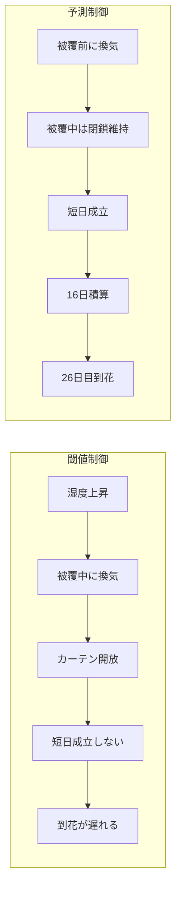

# 仮想ダリア栽培ハウスでの閾値／予測制御比較

ITエンジニア兼ダリア農家として、AIを使いつつ農家としての展開にも役立つ企画として作成しました。露地専門のため突っ込みどころが満載かもしれませんがご容赦ください。

同じ外気象条件で、  

- 閾値を超えてから動く制御  
- 将来を予測して先回りする制御

を比較するシミュレータです。

比較する指標は次の3つです。  
- 多湿の時間
- 灌水量
- 到花日

このデモでは、予測制御は湿度や土壌水分を数時間先まで予測し、被覆中の換気を避けるように動きます。

湿った外気シナリオでは、

- 予測制御: 到花 26日目
- 閾値制御: 期間内に到花せず

となりました。


## なぜ予測制御だと到花が早まるのか

このモデルの到花は、実際の開花日ではありません。
短日条件が成立した日数を積算し、16日に達した日を到花日としています。
被覆中に換気でカーテンを開けた場合、その日の短日は成立しないものとします。



- 閾値制御は**湿度が高くなってから換気**するため、湿った外気では被覆中の換気が増え、短日の積算が進みません。

- 予測制御は将来の湿度を見越して**事前に換気**するため、被覆中の換気を減らし、短日の積算を維持できます。  

このリポジトリで生成した結果では、予測制御は全シナリオで26日目に到花し、湿った外気の閾値制御は56日間で到花しませんでした。

## このデモで分かること

同じ外気象のうえで、次の2方針を比べます。

- **閾値制御**: 今の湿度、気温、土壌水分が線を超えてから換気・灌水・遮光する
- **予測制御**: 数時間先の室温・湿度・土壌水分を見て、今の換気・灌水・遮光を選ぶ

見る量は3つです。

- 多湿の時間（室温 12〜24℃かつ湿度 88% 以上の時間。順位づけ用の時間数です）
- 灌水量
- 到花日

差がいちばん大きいのは「湿った外気」です。予測制御は 26日目に到花し、閾値制御は期間内に到花しません。多湿の時間は 291 時間と 415 時間です。灌水量は 204 mm と 198 mm で、予測制御のほうが少ないとは限りません。

「基準」の閾値制御も期間内に到花しません（短日成立は 11 日）。「乾いた外気」の閾値制御は 41日目に到花します。予測制御はどちらも 26日目です。

## 予測制御は何を予測しているのか

予測するのは、1時間先の室温、室内の相対湿度、土壌水分です。到花日と外の天候は予測しません。手法は Ridge 回帰です。
毎時、次の8通り(換気 x 灌水 x 遮光)を候補にします。

- 換気: 閉 / 開
- 灌水: 0 mm / 4 mm
- 遮光: なし / 日射を約6割カット

各候補を、6時間先まで計算します。最初の1時間だけ、その候補の操作を使います。2時間目から先は、換気、灌水、遮光を切ったままにします。換気を切るのは、今開けた換気が被覆の時間まで続いている前提にしないためです。この計算でコストが小さい候補を1つ選び、今の操作にします。

コストに入るのは、多湿になりそうな時間、湿度の高さ、土壌の乾きと湿りすぎ、換気・灌水・遮光の使用、そして被覆中の換気です。被覆中の換気は、他の項より大きい罰則です。

学習データは、同じ簡略ハウスを3気象で乱数操作したときの遷移です。実ハウスの計測ではありません。画面に出る1時間先湿度の学習誤差（RMSE）は、この実行例で 0.93 ポイントです。

### Ridge回帰について
目的は予測精度を高めることではなく、予測を使う制御と使わない制御の比較です。  
室温・湿度・土壌水分は前時刻の状態や操作とほぼ連続的に変化するため、単純な線形モデルでも短時間先の予測ができます。  
Ridge 回帰は学習が速く、結果が安定し係数の解釈もしやすい（室温・湿度・土壌水分には相関があり、単純な線形回帰では係数が過度に大きくなりやすい）ため採用しています。  


## モデルの限界

数字は、2つの制御を同じ天候で並べるための簡略モデルです。  
実ハウスの収量予測、生産計画、灌水・換気・電照・被覆の指示には使えません。

このモデルは以下の条件を扱いません。
- 品種
- 個々の花
- 栽植密度
- 摘心
- 病害の診断
- CO2
- 実気象の観測
- 設備稼働時の動作遅延
- 経済性

多湿の時間は、灰色かび病のような条件の時間数です。診断ではありません。

外気象は「基準」「湿った外気」「乾いた外気」の合成です。乱数の種はシナリオごとに固定しています。予測モデルは、同じ簡略式から作った遷移で学習しています。

## 用語

**到花日**:  
  到花日は、特定の花が開いた日ではありません。ハウス全体を1つとして数えます。1日の終わりに、実効日長が 11.5 時間以下なら、短日成立を1日足します。この累計が 16 日に達した栽培日が到花日です。画面の数字は、開始日から数えた日数です。56日のあいだに届かなければ未到花で、指標は 56 です。

**被覆**:  
  被覆が日長を縮めます。電照はこのモデルにありません。自然日長が11時間より長いとき、正午を中心に11時間だけカーテンを開け、その前後の日照を覆います。成立判定のしきい値は 11.5 時間以下です。これは、目標の11時間より少し広い値です。

  被覆は最初の10日はしません。被覆すべき日照時間に換気でカーテンを開けると、その時間は光として数え、その日は積算に入りません。

  **遮光**は別の操作です。気温が高いときに日射を減らします。到花の日長計算には使いません。

**期間**:  
  期間は緯度 36 度、年間通日 160 から 56 日です。年間通日 160 は、うるう年でない年の 6月9日です（1月1日が通日1）。56日は通日 160 から 215 までで、6月9日から8月3日です。

## 画面で何を見るか

`http://localhost:8501` で外気象を「湿った外気」にします。表示の主値は予測制御です。差は、予測制御から閾値制御を引いた値です。負の値は、予測制御のほうが小さいことを示します。


ここで見ること:

- 到花が「26日目」で、差が「期間内に到花せず」であること
- 多湿の時間が 291 時間で、閾値制御の 415 時間より短いこと
- 灌水量の差は小さいこと。この気象では予測制御のほうが 6 mm 多い


ここで見ること:

- 4つの線は、同じ栽培日のうえに2方針を重ねたもの
- 湿度、気温、土壌水分は、どちらも日周期で動く
- 右下の換気は、0（閉）と 1（開）の時間値である。56日分を重ねると縦線になる
- 被覆中に開けた時間は、この図の上にある到花の表示に出る

## ディレクトリ構成

```text
app/streamlit_app.py    比較画面
src/ah_simu/
  weather.py            外気象（緯度・通日・56日）
  house.py              室温・湿度・土壌水分と、到花の積算
  photoperiod.py        被覆の時刻と、短日が成立したかの判定
  policies.py           閾値制御と予測制御
  model.py              1時間先の室温・湿度・土壌水分
  outcomes.py           多湿の時間、灌水量、到花日
  constants.py          共有の数値
  experiment.py         学習、評価、MLflow への記録
  __main__.py           train / eval / matrix
tests/                  ハウスと比較のテスト
argo/workflow.yaml      学習のあと、3気象×2方針を評価するワークフロー
Dockerfile              Argo 用イメージのビルド
requirements.txt
requirements-dev.txt
```

`runs/`、`mlflow.db`、`mlartifacts/` は実行すると作成されます。git には入っていません。画面で読み込まれるのは、`runs/summary.json` と、各方針の軌跡です。

## ローカルで見る

```bash
python3 -m venv .venv
.venv/bin/pip install -r requirements.txt
PYTHONPATH=src .venv/bin/python -m ah_simu matrix --out runs
PYTHONPATH=src RUNS_DIR=runs .venv/bin/streamlit run app/streamlit_app.py
```

ブラウザで `http://localhost:8501` を開きます。外気象を切り替え、予測制御と閾値制御で次が違うことを確認します。多湿の時間、灌水量、到花、そして湿度・土壌水分・気温・換気の線です。

記録は `mlflow.db`（実験名 `dahlia-house-control`）と `mlartifacts/` に残ります。各 run の params にはシナリオと方針が入り、metrics には3指標が入ります。

## 追跡サーバを別に立てる

先に MLflow を起動します。そのあと、ローカルで見るときと同じ評価コマンドを、この追跡サーバ向けに実行します。

```bash
.venv/bin/mlflow server --host 127.0.0.1 --port 5000 \
  --backend-store-uri sqlite:///mlflow.db \
  --default-artifact-root ./mlartifacts
MLFLOW_TRACKING_URI=http://127.0.0.1:5000 PYTHONPATH=src \
  .venv/bin/python -m ah_simu matrix --out runs
```

UI は `http://127.0.0.1:5000` です。

## 気象をワークフローで繰り返す

同じ処理は `argo/workflow.yaml` の一本です。

1. `train` が予測モデルを MLflow に置き、その artifact URI を次のステップへ渡します。
2. `eval` が baseline、wet、dry のそれぞれで閾値制御と予測制御を実行し、3指標を MLflow に残します。

このマシンでは、次のコマンドでその一本を実行します。`argo` コマンドは要りません。向け先のクラスタも要りません。画面用の `runs/summary.json` も、このコマンドが書きます。

```bash
PYTHONPATH=src .venv/bin/python -m ah_simu matrix --out runs
```

`argo submit` は、Argo CLI と、Argo Workflows が入ったクラスタがあるときだけ使います。イメージ `ah-simu:local` は、そのクラスタのノードから見える場所に置きます。`mlflow-uri` は、ワークフローの Pod から届く追跡サーバに合わせます。`http://mlflow.mlflow.svc.cluster.local:5000` はクラスタの中の名前で、この WSL からは参照できません。

```bash
docker build -t ah-simu:local .
argo submit argo/workflow.yaml \
  -p mlflow-uri=http://mlflow.mlflow.svc.cluster.local:5000 \
  -p image=ah-simu:local \
  --watch
```

## テスト

```bash
.venv/bin/pip install -r requirements-dev.txt
.venv/bin/pytest
```
